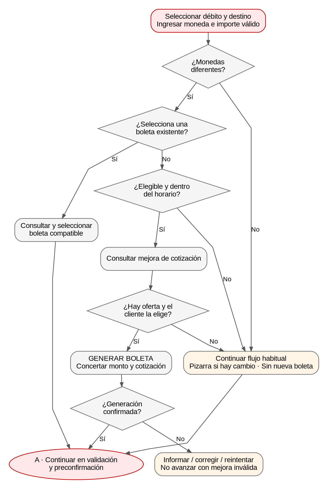
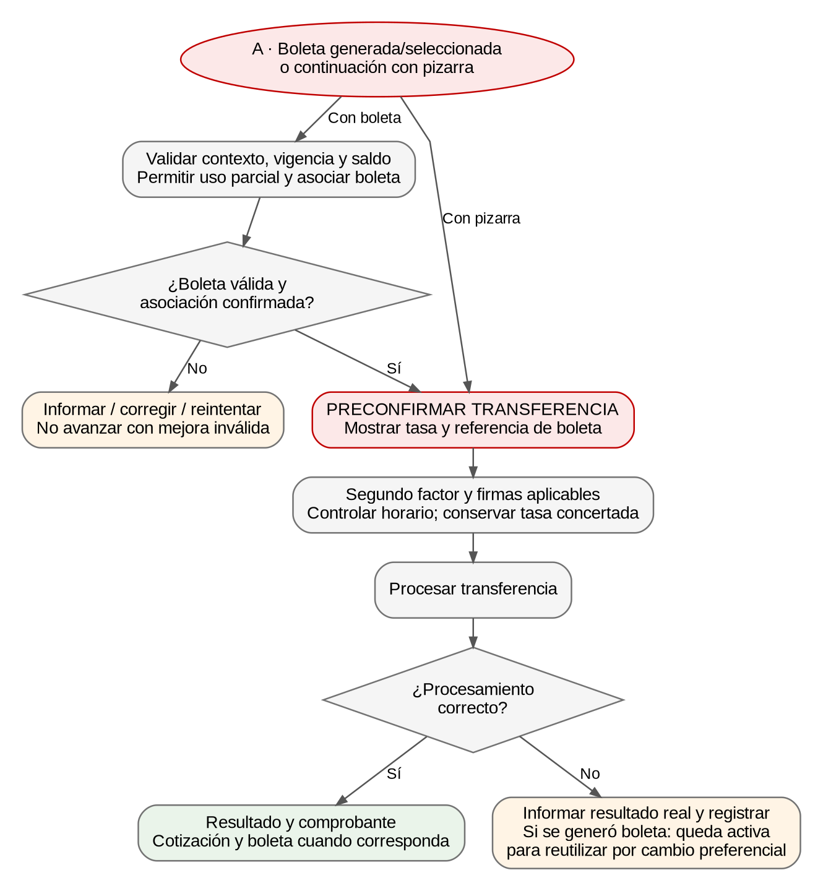

# Proyecto: M066-26 — Autogestión de mejora del tipo de cambio en e-Bank

Documento Técnico Canales (DTC) · Versión 0.1 · 02/11/2026 · Borrador para revisión técnica

### Objetivos

Permitir al cliente consultar y aplicar una mejora sobre la cotización de una transferencia cuando las monedas de débito y crédito sean diferentes. La funcionalidad estará disponible en Web y Mobile para transferencias SPI, SIPAP, cuentas propias, terceros mismo banco y exterior.

Integrar la consulta de oferta, la generación o selección de una boleta de cambio y su asociación a la transferencia antes de la preconfirmación. Reutilizar los controles y servicios transaccionales existentes, incluyendo cambio preferencial, autenticación, firmas y comprobantes.

### Diagrama de Flujo (Opcional)

Seleccionar débito y destino → identificar monedas → cargar importe → validar elegibilidad y horario → consultar oferta → generar o seleccionar boleta → validar saldo y asociar → preconfirmar → autenticar/completar firmas → procesar transferencia → mostrar resultado y comprobante.

Si las monedas son iguales, no se muestra mejora. Si no hay oferta, está fuera de horario o el cliente no utiliza la boleta, se continúa con pizarra conforme al flujo habitual. Si falla la transferencia después de concertar una boleta, esta permanece activa para reutilizarla mediante cambio preferencial.

### Menu de Acceso

Ubicación en el Menu: Transferencias → SPI / SIPAP / Cuentas propias / Terceros mismo banco / Exterior.

| Canales | Habilitación |
| --- | --- |
| Canales | WEB ☒   MOBILE ☒   BO ☐   NSBT ☐   BTW ☐   BTSERVICES ☐   ATM/POS ☐ |
| Personas | Físicas / Jurídicas: según segmentos habilitados por la entidad; matriz pendiente de confirmación. |

Identificar y catalogar el Rol (Acción en el sistema): usuario autorizado para operar las cuentas y ejecutar el tipo de transferencia seleccionado. La consulta, generación y utilización de boletas deben quedar sujetas al catálogo de permisos vigente. Identificadores concretos de roles y acciones: pendientes de confirmación.

### Condiciones/Validaciones

PRE-CONDICIÓN

| Condición | Requisito |
| --- | --- |
| Usuario, Operador Activo | SI. Sesión autenticada y usuario habilitado. |
| Productos Necesarios | Cuentas a la vista habilitadas para débito/crédito según transferencia. |
| Permiso Transaccional | SI. Reutilizar autorización de la transferencia. |
| Saldo en Producto | SI. Aplicar controles de saldo disponible existentes. |
| Permiso de Funcionalidad | SI. Según permisos y segmentos habilitados; catálogo pendiente. |
| Límite Transaccional | SI. Mantener límites de transferencia. No implementar en Banca límites ni cuantificación de generación de boletas. |
| 2FA Transaccional | Según mecanismo vigente de la transferencia; no sustituirlo por validación local. |
| Monedas Permitidas | PYG, USD y EUR en el contexto de e-Bank; pares habilitados según Core. Exterior conserva su catálogo vigente. |
| Envío de Mail | Según servicio transaccional existente; confirmar eventos y obligatoriedad. |

Condiciones Adicionales

- Contar con débito y destino seleccionados. En exterior, identificar cuenta de débito, moneda de envío y beneficiario autorizado.

- Si la moneda de débito coincide con la de crédito, no habilitar mejora y continuar con la moneda común.

- Si las monedas son diferentes, obtener la cotización pizarra, su unidad y el sentido compra/venta desde el servicio correspondiente.

- Consultar una oferta sólo con importe mayor que cero y datos de operación consistentes. La habilitación depende de segmento, monedas, horario y calendario definidos en Core.

- Fuera del horario habilitado para mejora, no habilitar la consulta y conservar la cotización pizarra. Separar este horario del horario de procesamiento de transferencias y del valor de exterior.

- Transferencias SPI/SIPAP, propias y terceros mismo banco: aviso de mejora en días hábiles de lunes a viernes, de 08:00 a 15:59 Hs. Exterior: de 08:00 a 14:59 Hs. Confirmar zona horaria, calendario y extremos inclusivos del servicio.

- Conservar los controles vigentes de horario, tipo de transferencia, comisiones, programación y firmas. La compatibilidad de programación con boleta requiere definición de Core.

- Los umbrales y cantidades de generación de boletas son responsabilidad de Core. No codificar un tope fijo de USD 300.000 en el canal.

Resultado Esperado.

- El cliente visualiza la pizarra y, cuando aplica, consulta una oferta y compara la cotización mejorada y la diferencia por unidad.

- La generación confirmada presenta la boleta, su saldo y su cotización. Una boleta existente puede seleccionarse sin generar otra.

- La boleta queda asociada antes de preconfirmación, sin considerar finalizada la transferencia por el solo hecho de generarla.

- La transferencia se procesa con pizarra o con la tasa concertada. Una variación de pizarra posterior a preconfirmación no reemplaza la tasa concertada.

- El resultado refleja el estado transaccional real; el comprobante muestra la cotización utilizada y, cuando corresponda, la referencia de boleta.

- Si falla la transferencia después de generar la boleta, esta queda activa para reutilizarse mediante cambio preferencial y se registra la trazabilidad.

Validaciones de negocio

Canal:

- Validar importe mayor que cero, campos obligatorios y formato monetario. PYG sin decimales y monedas extranjeras con la precisión vigente; redondeo y precisión contractual pendientes de confirmación.

- Mantener controles existentes de saldo, límites transaccionales y permisos; no duplicar en el canal las reglas de elegibilidad de generación de Core.

- Ocultar mejora con monedas iguales o boleta aplicada. No deducir elegibilidad por la presencia de USD ni por pares fijos de demostración.

- Presentar la oferta dentro del formulario, debajo de la pizarra y sin ventana emergente. Mostrar tasa actual, mejorada y diferencia por unidad.

- Invalidar la oferta no concertada cuando cambien cuentas, monedas o importe; exigir nueva consulta antes de generar.

- GENERAR BOLETA debe concertar el monto y la tasa ofertados. Mostrar éxito sólo después de la respuesta confirmada del servicio.

- Permitir uso parcial: importe de la transferencia menor o igual al saldo de boleta. Antes de comparar, resolver moneda y unidad del saldo con el contrato de Core.

- Para cambiar cuentas con boleta aplicada, solicitar dejar de usarla o reiniciar selección; nunca reutilizarla silenciosamente en un contexto incompatible.

- NO USAR BOLETA restablece pizarra. Una boleta existente permanece disponible. Para una boleta generada en el flujo, confirmar si la operación requiere desvinculación o baja; si requiere baja y falla, mantenerla aplicada hasta confirmación.

- Bloquear acciones duplicadas durante consulta, generación y asociación. Ante timeout con resultado incierto, consultar estado antes de repetir una operación irreversible; mecanismo de idempotencia pendiente de contrato.

- Sin oferta: conservar pizarra y permitir continuar, informando cuando corresponda. Error de consulta: informar y permitir reintento.

- Error de generación: mensaje genérico para negocio o indisponibilidad; no presentar boleta como generada. Reintento o continuidad con pizarra según reglas de Core.

- Oferta vencida o fuera de horario: no procesar con mejora. El rechazo total de la transferencia o el retorno a una alternativa requiere definición funcional antes de implementar.

Core / servicios transaccionales:

- Determinar elegibilidad por cliente/segmento, monedas, monto, horario y día hábil; aplicar parametrización de mejora y controles de generación.

- Validar propiedad, compatibilidad, vigencia y saldo de la boleta; devolver tasa, unidad y estado autorizados para la operación.

- Confirmar y asociar antes de preconfirmación según secuencia acordada. El punto preciso de validación/reserva/confirmación y el control en firmas deben quedar definidos en el contrato.

- Mantener la tasa concertada ante variaciones posteriores de pizarra. Aplicar control de horario al aprobar operaciones con firmas.

- Conservar boleta activa si falla la transferencia, y actualizar saldo/consumo sólo de acuerdo con el resultado definitivo.

- Registrar correlación entre oferta, boleta y transferencia, canal, fechas y resultados. No registrar credenciales ni códigos de autenticación.

### Flujos de pantallas

Pantalla inicial: Formulario de Transferencias

Campos de pantallas.

| Long. | Label | I/O | Tipo de dato | Formato/Validación | Fuente | Requerido | Editar |
| --- | --- | --- | --- | --- | --- | --- | --- |
| Contrato | Cuenta Débito | I | Identificador | Cuenta autorizada con permiso de débito | Sesión / servicio cuentas | SI | Antes de aplicar boleta |
| Contrato | Cuenta Crédito / Beneficiario | I | Identificador | Destino válido según transferencia | Servicio destinos | SI | Antes de aplicar boleta |
| Contrato | Moneda | I | Enumerado | ISO; par habilitado | Catálogo / selección | SI | Según contexto de boleta |
| Contrato | Importe | I | Decimal | > 0; saldo de cuenta y de boleta cuando aplica | Input | SI | SI; permite uso parcial |
| Contrato | Cotización pizarra | O | Decimal | Tasa, sentido y unidad | Servicio cotizaciones | Con cambio | NO |
| N/A | Consultar mejora de cotización | I | Acción | Importe válido, elegibilidad y horario | Usuario / servicio | NO | Disponible si aplica |
| Contrato | Cotización mejorada | O | Decimal | Oferta vigente vinculada al contexto | Servicio oferta | Con oferta | NO |
| Contrato | Diferencia por unidad | O | Decimal | Diferencia y unidad según sentido de cambio | Oferta / cálculo validado | Con oferta | NO |
| N/A | GENERAR BOLETA | I | Acción | Oferta actual; evitar doble envío | Usuario / concertación | NO | Con oferta válida |
| Contrato | Boleta / Saldo / Cotización | O | Identificador / Decimal | Estado, moneda/unidad y saldo confirmados | Servicio boletas | Con boleta | NO |
| Contrato | Seleccionar boleta existente | I | Identificador | Compatible y con saldo | Servicio cambio preferencial | NO | Sin otra aplicada |
| N/A | NO USAR BOLETA | I | Acción | Restablecer pizarra tras resultado requerido | Usuario / servicio | NO | Con boleta aplicada |
| Contrato | Concepto | I | Texto | Reglas de transferencia existentes | Input | Según flujo | SI |
| Contrato | Programar transferencia | I | Booleano / Fecha | Compatibilidad con boleta por confirmar | Input | NO | Según flujo |
| N/A | SIGUIENTE | I | Acción | Requeridos válidos, saldo y asociación completada | Usuario / servicios | SI | Sin solicitudes pendientes |

Long. “Contrato” indica longitud/precisión pendiente de especificación del servicio existente; no se establecen valores arbitrarios. I: entrada o acción. O: salida. Requeridos: resaltar los campos faltantes y mostrar un mensaje que permita corregirlos.

Exterior: completar además Valor, Motivo, Gastos en el exterior, Cancelación importe de gastos, Detalle del motivo y Adjuntos conforme al formulario vigente. Mantener búsqueda, alta, edición y eliminación de beneficiarios por el circuito autorizado existente. Longitudes, formatos y obligatoriedad contractual de estos campos deben validarse con el servicio de exterior.

Los adjuntos del prototipo admiten PDF/JPG/JPEG/PNG/GIF hasta 3 MB por archivo. Confirmar las restricciones vigentes del servicio de exterior antes de utilizar estos valores en producción.

| Detalle | Acción |
| --- | --- |
| Flujo principal 1 | 1. Seleccionar débito y destino. 2. Identificar monedas y obtener pizarra. 3. Cargar importe y datos requeridos. 4. Validar elegibilidad/horario y consultar mejora. 5. Mostrar comparación en el formulario. 6. GENERAR BOLETA y cargar identificador, saldo y tasa confirmados. 7. Validar saldo y completar asociación. 8. Seleccionar SIGUIENTE y mostrar preconfirmación. |
| Alternativa: pizarra | Monedas iguales, sin oferta o mejora no utilizada: continuar por el flujo habitual sin nueva boleta. |
| Alternativa: boleta existente | Consultar disponibles, seleccionar compatible y utilizar su tasa sin generar otra; permitir dejar de usarla. |
| Alternativa: cambios / errores | Invalidar oferta al cambiar contexto antes de concertación. Si falla generación, no mostrar éxito. Si una baja requerida falla, mantener aplicación hasta confirmación. |
| Particularidades de exterior | Mostrar aviso de horarios por moneda y valor. El horario de mejora es independiente de dicho aviso. Permitir uso parcial de boleta según saldo; no replicar el bloqueo total del monto del prototipo. |

Invocaciones de servicios:

- Obtener cuentas, destinos y monedas mediante servicios existentes de la transferencia. Nombres y contratos definitivos pendientes de confirmar.

- Obtener pizarra y controlar horario de cotización antes de habilitar la mejora.

- Consultar oferta con contexto de cliente autorizado, cuentas/destino, monedas y monto.

- Concertar boleta desde la oferta vigente. Consultar boletas cuando sea necesario para recuperar la generada o seleccionar una existente.

- Validar saldo/vigencia y asociar boleta a la transferencia antes de preconfirmación.

- Dejar de usar boleta según el contrato acordado de desvinculación o baja; no interpretar automáticamente ambas acciones como equivalentes.

Pantalla de preconfirmación: Confirmar Transferencia

| Condición | Aplicación |
| --- | --- |
| Segundo Factor | SI, según mecanismo transaccional vigente. |
| Esquema de firma | Aplicar el esquema vigente de la cuenta/operación; la mejora no lo elimina. |

Campos de pantalla

| Label | I/O | Tipo de dato | Formato/validación | Fuente | Validar |
| --- | --- | --- | --- | --- | --- |
| Cuenta Débito | O | Identificador / Texto | Cuenta seleccionada y autorizada | Transacción preparada | SI |
| Cuenta Crédito / Beneficiario | O | Identificador / Texto | Destino de la operación | Transacción preparada | SI |
| Moneda e Importe | O | Enumerado / Decimal | Formato monetario vigente | Transacción preparada | SI |
| Cotización utilizada | O | Decimal | Pizarra o concertada; unidad y sentido | Transacción preparada | SI |
| Referencia de boleta | O | Identificador | Obligatoria cuando se utiliza boleta | Asociación confirmada | SI |
| Importe débito / crédito y total | O | Decimal | Conversión y redondeo autorizados | Servicio transaccional | SI |
| Concepto / Comisiones | O | Texto / Decimal | Según tipo de transferencia | Servicio transaccional | Según flujo |
| Programación / Valor exterior | O | Fecha / Enumerado | Según circuito y compatibilidad definida | Servicio transaccional | Según flujo |
| Segundo factor | I | Según mecanismo | Validación remota; no aceptar códigos arbitrarios | Servicio autenticación | SI |
| Estado de firmas | O | Enumerado | Según esquema vigente | Servicio firmas | Si aplica |

| Detalle | Acción |
| --- | --- |
| Flujo principal 2 | 1. Presentar resumen con tasa y referencia de boleta cuando aplique. 2. Obtener y validar el segundo factor mediante mecanismo vigente. 3. Solicitar confirmación de la transferencia sin duplicar concertación. 4. Completar firmas cuando corresponda. 5. Mostrar resultado definitivo o estado pendiente real. |
| Control de tasa y horario | Conservar la tasa concertada si cambia la pizarra después de preconfirmación. Validar horario en la aprobación. La secuencia de reserva/confirmación y el tratamiento de vencimiento deben ser acordados con Core. |

Invocaciones de servicios:

Reutilizar preparación/confirmación de transferencia, segundo factor y firmas existentes. Enviar referencia de boleta y tasa mediante el contrato de asociación aprobado. No utilizar los temporizadores ni la aceptación local de seis dígitos del prototipo como implementación transaccional.

Pantalla de resultado: Comprobante de transferencia.

| Función | Aplicación |
| --- | --- |
| Descargar comprobante. | SI, según formato y servicio vigentes. |
| Enviar correo automático. | Según eventos existentes; obligatoriedad por confirmar. |

Campos de la pantalla

| Label | I/O | Tipo de dato | Formato/validación | Fuente |
| --- | --- | --- | --- | --- |
| Estado de operación | O | Enumerado / Texto | Éxito, pendiente o error real | Servicio transferencia |
| Cuenta Débito | O | Identificador / Texto | Enmascaramiento vigente | Servicio transferencia |
| Cuenta Crédito / Beneficiario | O | Identificador / Texto | Destino de la operación | Servicio transferencia |
| Moneda e Importe | O | Enumerado / Decimal | Formato monetario vigente | Servicio transferencia |
| Cotización utilizada | O | Decimal | Tasa efectivamente aplicada y unidad | Servicio transferencia |
| Referencia de boleta | O | Identificador | Mostrar cuando corresponda | Servicio transferencia / boletas |
| Número de operación / Referencia | O | Identificador | Referencia transaccional real | Servicio transferencia |
| Fecha/hora de realización / imputación | O | Fecha-hora | Hora autorizada del sistema | Servicio transferencia |
| Concepto / Comisiones / Total | O | Texto / Decimal | Datos definitivos de la operación | Servicio transferencia |
| Código resultado operación | O | Código / Texto | Traducir a mensaje funcional autorizado | Servicio transferencia |

Verificaciones pos transacción/proceso:

- Validar la contabilización de la operación en Bantotal mediante el mecanismo vigente.

- Confirmar que el comprobante contiene la tasa aplicada y referencia de boleta cuando corresponda; no mostrar referencias ficticias.

- Verificar consumo y saldo remanente de boleta según el resultado definitivo.

- Ante fallo de transferencia tras concertación, conservar la boleta activa para reutilización y registrar correlación de la incidencia.

- No registrar tokens, claves dinámicas ni datos sensibles sin enmascarar. Mantener trazabilidad de oferta, boleta, transferencia y resultado.

### 6. Servicios a Desarrollar

Las capacidades siguientes deben integrarse con los servicios existentes de transferencias y cambio preferencial. Se detalla la información necesaria para desarrollo; los contratos no confirmados se indican expresamente. Los nombres de operaciones de oferta/boleta son funcionales y no implican endpoints aprobados.

1- control-horario-cotizacion

Servicio Core: BTSControlarHorarioCotizacion. Endpoint de referencia técnica por confirmar: GET /servicios-datos/control-horario-cotizacion.

Request: Body vacío para el endpoint GET de referencia. Encabezados según seguridad del gateway; Content-Type: application/json y autenticación por el mecanismo configurado. No incorporar claves o tokens al código ni al documento.

Response: debe permitir determinar si puede operar y, cuando corresponda, el horario habilitado y motivo de rechazo. Confirmar estructura definitiva: controlarHorario/retornarHorario se encuentran expresados como booleanos en el ejemplo disponible, mientras el diccionario los tipa como String; además se describen Estado y Erroresnegocio sin una respuesta completa.

Diccionario de datos:

| Atributo | Tipo de dato | In/Out | Requerido/Opcional |
| --- | --- | --- | --- |
| controlarHorario | Por confirmar: booleano frente a String | Según contrato Core | Por confirmar |
| retornarHorario | Por confirmar: booleano frente a String | Según contrato Core | Por confirmar |
| Habilitación / Estado | Tipo y nombre definitivos pendientes | O | Necesario funcionalmente |
| Detalle de negocio / horario | Estructura pendiente | O | Según resultado |

Consideraciones: el servicio debe ser la autoridad de horario/calendario; no utilizar la hora del dispositivo ni escenarios de demostración. Confirmar tratamiento de indisponibilidad: se propone no habilitar la mejora, conservar pizarra y alertar internamente sin exponer detalles técnicos.

2- Consulta de oferta de mejora

Servicio Core y Endpoint: pendientes de definición.

Request: contexto de cliente desde sesión autorizada, tipo de transferencia, cuentas/destino, monedas y moneda/importe de la operación. Confirmar identificadores, tipos, longitudes y obligatoriedad del contrato.

Response: elegibilidad y existencia de oferta; identificador de oferta, pizarra, tasa mejorada, unidad/sentido y vigencia cuando aplique. Sin oferta no es equivalente a error técnico.

Diccionario de datos:

| Atributo lógico | Tipo de dato propuesto | In/Out | Requerido/Opcional |
| --- | --- | --- | --- |
| Contexto de operación | Estructura por definir | I | Necesario |
| Importe y moneda | Decimal / ISO | I | Necesario |
| Oferta / elegibilidad | Identificador / Estado | O | Necesario |
| Tasas y unidad | Decimal / Texto | O | Con oferta |
| Vigencia / motivo | Fecha-hora / Código | O | Según contrato |

Consideraciones: Core controla segmento, par de monedas, día hábil, horario y parámetros de generación. Invalidar la oferta local al cambiar contexto antes de concertar.

3- Generación de boleta de cambio

Servicio Core y Endpoint: pendientes de definición o identificación del servicio reutilizable.

Request: oferta y contexto de operación consistentes. Acordar correlación e idempotencia para evitar duplicación ante doble envío o timeout.

Response: referencia de boleta, tasa concertada, saldo, moneda/unidad y estado confirmado. Mostrarla como generada sólo después de confirmación remota.

Diccionario de datos:

| Atributo lógico | Tipo de dato propuesto | In/Out | Requerido/Opcional |
| --- | --- | --- | --- |
| Oferta / contexto | Identificador / Estructura | I | Necesario |
| Correlación / idempotencia | Identificador por definir | I | Acordar contrato |
| Boleta / estado | Identificador / Enumerado | O | Necesario |
| Tasa / saldo / moneda / unidad | Decimal / ISO / Texto | O | Necesario |

Consideraciones: error de negocio o indisponibilidad muestra mensaje genérico, sin boleta ficticia. Permitir reintentar o continuar con pizarra conforme a Core. Ante resultado incierto, consultar estado antes de repetir.

4- Validación y asociación de boleta a la transferencia

Servicio Core y Endpoint: pendientes de definición o extensión del servicio transaccional existente.

Request: boleta, transacción en preparación, contexto, importe y moneda. Response: asociación confirmada, tasa autorizada y datos de preconfirmación, o rechazo funcional.

Consideraciones: generar y asociar antes de preconfirmación; acordar si existen reserva y confirmación separadas y qué se revalida en la confirmación final y en firmas. No sustituir automáticamente la tasa concertada por una pizarra posterior. Definir rechazo o alternativa ante vencimiento; no procesar con mejora vencida.

Consideraciones generales para implementación:

- Confirmar los contratos definitivos de cuentas, monedas, destinos, pizarra, boletas y transferencia; completar métodos, autenticación, tipos, longitudes y códigos de error antes de integración.

- Definir precisión, redondeo, sentido de conversión, moneda y unidad de saldo. No utilizar tasas ni cálculos de demostración como contrato financiero.

- Confirmar permisos, personas/segmentos habilitados, pares de monedas, calendario, zona horaria y compatibilidad con programación y firmas.

- Completar preconfirmación/resultado de exterior y adaptación Mobile con los componentes existentes. Incluir referencia de boleta en comprobantes.

- El prototipo entregado depende de pizarra/rates.js, archivo no incluido. Sus servicios son simulados: no acreditan integración ni seguridad. Resolver la dependencia para usarlo en pruebas, sin trasladarla a producción.

- Validar en integración: monedas iguales; pizarra; consulta con/sin oferta; generación y errores; boleta existente; cambio de contexto; no uso/baja; saldo parcial/igual/superado; límites horarios; vencimiento; variación de pizarra; firmas; fallo de transferencia y comprobante.
